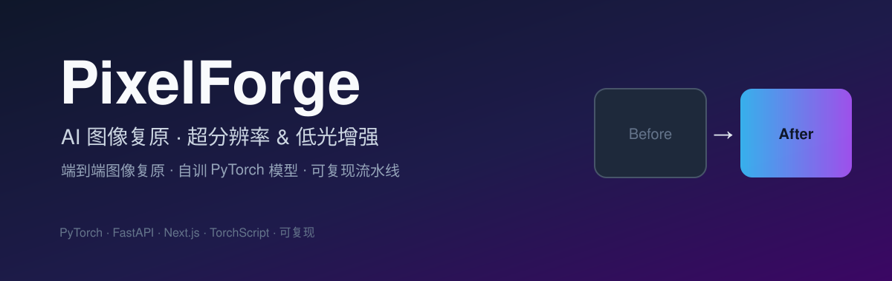
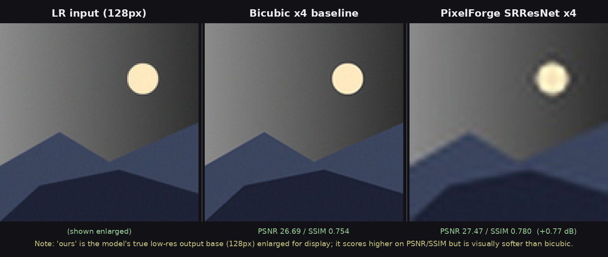
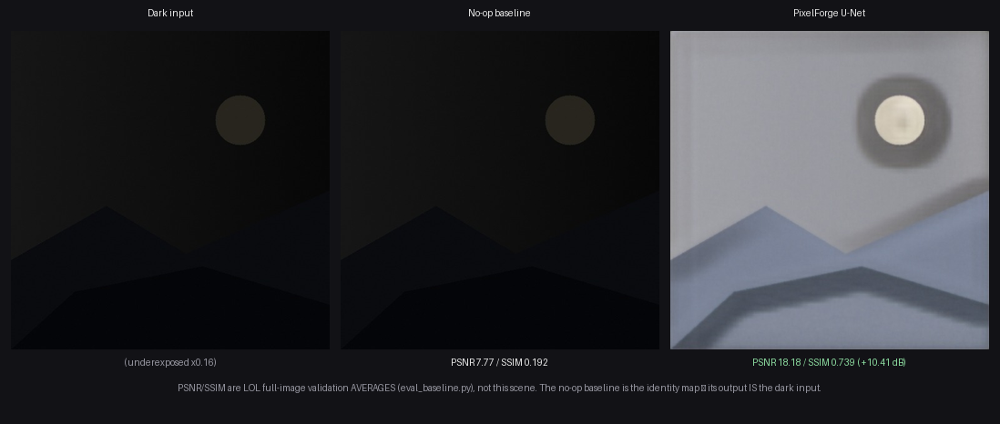
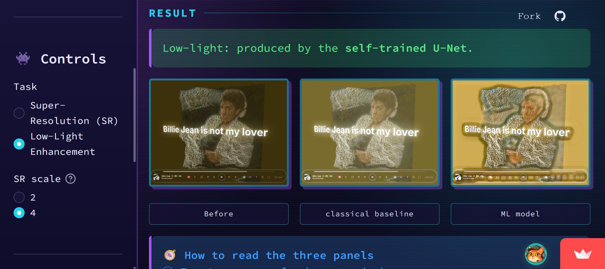
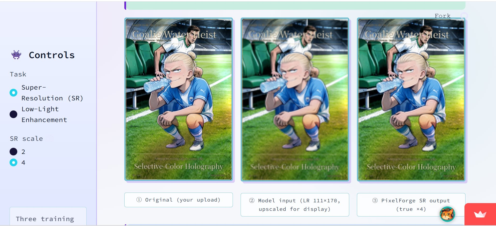
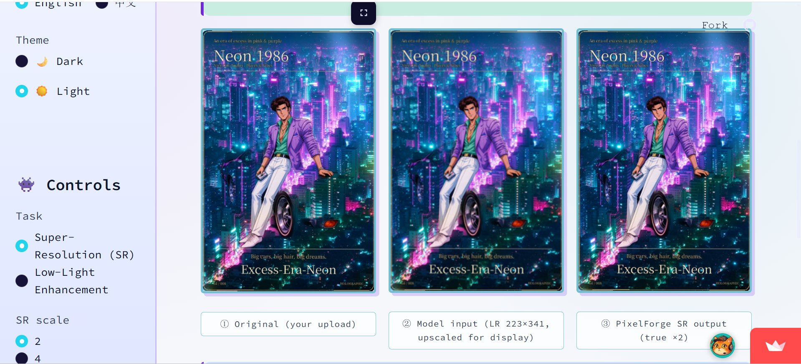

<p align="center">
  
</p>

<p align="center">
  <a href="https://pixelforge-image-restoration.streamlit.app/"></a>
  <a href="https://doi.org/10.20944/preprints202611.0550.v1"></a>
  <a href="https://github.com/ElijahZhao/pixelforge-image-restoration-/actions/workflows/ci.yml"></a>
  
  
  <a href="LICENSE"></a>
</p>

<p align="center">
  <b>PixelForge</b> —— 一条克隆下来就能跑通的端到端图像复原管线。<br/>
  三个全自训 PyTorch 模型，覆盖 ×2/×4 单图超分与低光增强，从数据、训练、评测一直到部署。零外部推理 API。
</p>

<p align="center">
  <a href="https://pixelforge-image-restoration.streamlit.app/"><b>在线 Demo</b></a> &nbsp;·&nbsp;
  <a href="#-快速开始">快速开始</a> &nbsp;·&nbsp;
  <a href="#-评测结果">评测结果</a> &nbsp;·&nbsp;
  <a href="#-论文与引用">论文</a> &nbsp;·&nbsp;
  <a href="README.md">English</a>
</p>

---

## 🎯 这是什么

一条从零写起、可复现的视觉管线：

```
数据 → 训练 → 评测 → 导出（TorchScript）→ FastAPI 服务 → 网页前端
```

三个推理权重随仓库发布（4.9 + 3.2 + 2.3 MB），克隆即可在 CPU 上跑起来——Demo、API 和整套测试都不需要 GPU。下文每个数字都用同一验证集、同一套指标实现测得，且口径是写明的，不是默认的。

## ✨ 核心亮点

- **三个模型，全部自写**：SRCNN（0.069 M，用于种子方差研究）、SRResNet 生成器（×4 1.22 M，×2 0.78 M）、低光 U-Net（0.565 M）。唯一的预训练组件是训练期感知项用的 VGG16，它不参与推理。
- **三个任务都赢过经典基线**：超分 ×4 +0.77 dB、×2 +1.31 dB（对 bicubic），低光 +10.55 dB（对 No-op）——用的就是本仓库发布的权重。
- **可复现是结构性的**：126 个逐图 PSNR/SSIM CSV 支撑 126 个报告单元，`scripts/verify_public_release.py` 重新求平均并逐格核对矩阵。
- **交付的是产品，不是 notebook**：FastAPI（per-IP 限流 + 上传守卫）、中英双语 Streamlit Demo、Next.js 前端、非 root Docker 镜像。
- **CI 把关**：101 项测试 + 75% 覆盖率门禁、依赖审计、前端类型检查与构建，以及一个重新生成全部表格、重编译论文的论文作业。

## 🖼️ 效果预览

| 超分 ×4 | 低光增强 |
|:---:|:---:|
|  |  |
| Bicubic 26.69 dB / 0.754 → **27.47 / 0.780** | No-op 7.77 / 0.192 → **18.32 / 0.746** |

两张图都由 `scripts/make_compare.py` 在 CPU 上用发布的权重现场生成。

**线上实况**——公开 Demo 的三栏视图（你的上传、模型实际看到的输入、输出）。同一页面带暗/亮主题切换与中英文切换。



<details>
<summary>更多截图（超分 ×4 / ×2，暗色与亮色主题）</summary>





| 原始上传（446×683） | 模型输入（223×341） | PixelForge ×2 输出（446×682） |
|:---:|:---:|:---:|
|  |  |  |

</details>

## 📊 评测结果

| 任务 | 经典基线 | PixelForge | 增益 |
|---|---|---|---|
| **超分 ×4** | Bicubic 26.69 dB / 0.754 | **27.47 / 0.780** | **+0.77 dB / +0.026** |
| **超分 ×2** | Bicubic 31.04 / 0.894 | **32.35 / 0.917** | **+1.31 dB / +0.023** |
| **低光增强** | No-op 7.77 / 0.192 | **18.32 / 0.746** | **+10.55 dB / +0.553** |

三行口径一致：全图验证（DIV2K val 100 张、LOL 15 对）、RGB PSNR/SSIM、逐图求平均、LR 由 PIL 双三次下采样生成——与挑选部署权重时同一个协议。超分两行若用 `scripts/protocol_matrix.py` 按 **P8**（全图、RGB、逐图平均）重测，读数为 **27.4977 / 32.4243 dB**。

写明协议是必要的，但不充分——名字并不能固定住测量。同样权重、同样 100 张图：

| 改动 | Δ PSNR |
|---|---|
| PIL bicubic → torchvision bicubic + antialias，都在浮点上 | **0.012 dB**（27.4977 → 27.5098） |
| 同一个 torchvision 调用，`antialias` 开 → 关 | **3.73 dB**（28.95 → 25.21） |
| 同一算子，但 LR 经过一次 8-bit 往返 | **1.96 dB**（27.51 → 25.55） |

第三行不是假设：那是本项目某个内核在“torchvision bicubic + antialias”标签下真实记录到的结果。`to_pil_image` 会 clamp 到 [0, 1]，而双三次下采样必然过冲，携带边缘能量的振铃就这样被截掉了。

<details>
<summary>种子方差、算力台账，以及<b>不</b>声称的内容</summary>

**种子方差**——训练内验证口径（随机裁块、逐图平均），**不可**与上表的全图数字相减。每任务 5 次独立训练：

| 任务 | 末轮 PSNR（均值 ± 标准差，n=5） | 95% CI |
|---|---|---|
| 超分 ×2（SRCNN，100 轮） | 30.686 ± 0.069 | [30.601, 30.771] |
| 超分 ×4（SRResNet，200 轮） | 26.422 ± 0.036 | [26.378, 26.466] |
| 低光（U-Net，200 轮） | 18.032 ± 0.104 | [17.903, 18.161] |

种子只把结果推动 0.04–0.10 dB，而 `antialias` 一个开关就推动 3.73 dB。**决定数字的不是种子，是协议标签。**日志见 [`results/seeds/`](results/seeds/)。

**测量成本**：上述数字全部来自 Kaggle 免费 T4 内核，逐次记账——34 次内核、29.05 h 机器墙钟时间（GPU 21.72 h、CPU 7.33 h），其中 6.84 h 耗在 11 次失败或作废的运行上；种子方差背后是 15 次训练（3 任务 × 5 种子）、2 500 个 epoch。明细见 [`results/compute_ledger.md`](results/compute_ledger.md)。

**不声称**：不是 SOTA。超分 ×4 的 27.47 dB 高于 bicubic，但低于大数据集的学术结果（30+ dB）——训练集与网络容量都是刻意压小的。低光增益是相对 No-op 基线，不是相对已发表方法。

</details>

## 🚀 快速开始

**A. 公开 Demo —— 不用装任何东西**

<https://pixelforge-image-restoration.streamlit.app/> —— 免费档会休眠，首次访问可能要等几秒唤醒。

**B. 本地跑同一个 Demo**

```bash
pip install -r deploy/streamlit/requirements.txt   # CPU 版 torch，按免费档固定
streamlit run deploy/streamlit/streamlit_app.py
```

**C. 自托管 API 与前端**

```bash
# 后端 —— requirements.txt 不锁 torch，按机器自行安装
pip install -r requirements.txt
pip install torch torchvision                      # 开发机装 CPU 版；GPU 机器装 CUDA 版
uvicorn serve.app:app --reload --port 8000

# 前端（另一个终端）
cd web
cp .env.local.example .env.local                   # 默认指向 http://localhost:8000
pnpm install
pnpm dev                                           # http://localhost:3000
```

**D. Docker（仅后端）**

```bash
docker build -t pixelforge-serve .
docker run -p 8000:8000 pixelforge-serve
```

镜像自带权重并以非 root 用户（uid 10001）启动，默认走 ML 引擎。前端是独立构建目标，不在此镜像内。

## 📁 项目结构

```
pixelforge-image-restoration/
├── assets/              # banner 与真实对比图 / 演示截图
├── data/                # 数据集说明（数据本身不入库）
├── models/              # 训练检查点（每轮最优）
├── results/             # 协议矩阵、逐图 CSV、种子日志、算力台账
├── train/               # models.py / datasets.py / metrics.py / train.py / export.py / tests/
├── serve/               # FastAPI、经典回退、权重加载、models/*.pt
├── deploy/streamlit/    # 公开 Demo（自包含，纯 CPU）
├── web/                 # Next.js 14 + Tailwind 前端
├── paper/               # LaTeX 原稿、FACTS.md、refs.bib、tables/
├── preprint/            # 平台版与投稿版 PDF、源码包、图形摘要
├── scripts/             # 评测、协议矩阵、出图与论文门禁
├── tests/               # API 冒烟、真实权重集成、E2E 浏览器流程
├── docs/API.md          # HTTP 接口参考
├── Dockerfile           # 推理服务镜像
└── DEPLOY.md            # 部署指南
```

## 🛠️ 技术栈

| 层 | 技术 |
|---|---|
| 建模 | PyTorch 2.x、TorchVision、TorchScript |
| 训练 | Adam、余弦退火、AMP、Charbonnier 损失、可选 VGG 感知项 |
| 指标 | PSNR、SSIM（11×11 高斯窗，σ = 1.5） |
| 后端 | FastAPI / Uvicorn、Pillow |
| 前端 | Next.js 14、React 18、TypeScript、Tailwind CSS |
| 部署 | Streamlit Community Cloud、Docker、Vercel（可选） |

## 🧪 测试

```bash
python -m pytest                                    # 101 passed, 1 skipped（跳过的是 E2E 模块）
python -m pytest --cov --cov-report=term-missing    # 覆盖率门禁 75%
cd web && pnpm test && pnpm exec tsc --noEmit
```

被跳过的是 `tests/e2e/test_e2e.py`，它驱动真实 Chromium 走完整上传流程；可直接运行，或设 `PIXELFORGE_RUN_E2E=1`。预印本正文写的是 81 项测试——那是发布时的数量；此后新增 7 项服务守卫测试与 12 项数据管道测试，因此仓库现在是 101 项。CI 跑四个作业：测试 + 覆盖率门禁、锁文件 `pip-audit`、前端类型检查 + 测试 + 构建，以及一个重新生成全部表格、重编译论文、检查版面、独立复算头条数字、审计 27 条参考文献（83 项核验）的论文作业。

## ❓ 常见问题

**需要 GPU 吗？**
不需要。公开 Demo、本地 Demo、API 和整套测试都在 CPU 上跑，只有训练需要 GPU。

**哪些任务有训练好的权重？**
三个都有：超分 ×4、×2 与低光。万一某个权重文件缺失，服务会对该槽位回退到经典方法而不是报错——`GET /api/health` 会报告每个槽位当前用的是哪个引擎。

**超分 ×4 曾被说成“比 bicubic 更软”，是真的吗？**
不是，而且它也并不更软。在 9 张图上用四种梯度定义重测，模型在 **9/9** 张上都比 bicubic 更锐（亮度梯度均值 **1.92 vs 1.45**）。PSNR 也不是感知项换来的：带 `--perceptual` 训练得 27.61 / 0.7835，不带得 27.60 / 0.7836，差 0.01 dB。本 README 早前的版本写过相反结论（1.39 vs 1.45），两半都错，已撤回。

**为什么 Demo 第一次打开很慢？**
Streamlit 免费档空闲即休眠，首次访问要等它唤醒。推理本身在 CPU 上，普通照片很快。

**网络受限的环境能跑吗？**
可以——见 [DEPLOY.md](DEPLOY.md)，GitHub 不可直连时可用镜像推镜像。

## 📄 论文与引用

本仓库在代码里执行的评测纪律，已写成一篇预印本：

- **题目**：*The Protocol Is the Result: How Evaluation Choices Flip the Verdict on Lightweight Image Restoration*
- **作者**：Yulin Zhao（Elijah Zhao）—— 独立研究者
- **出处**：Preprints.org，Article，2026-11-05 发布（未经同行评审，CC BY 4.0）
- **DOI**：[10.20944/preprints202611.0550.v1](https://doi.org/10.20944/preprints202611.0550.v1)
- **文件**：15 页平台版在 [`preprint/published/`](preprint/published/)，投稿版与源码在 [`preprint/submission/`](preprint/submission/)，LaTeX 在 [`paper/`](paper/)

<details>
<summary>BibTeX</summary>

```bibtex
@article{zhao2026protocol,
  title   = {The Protocol Is the Result: How Evaluation Choices Flip the Verdict
             on Lightweight Image Restoration},
  author  = {Zhao, Yulin},
  journal = {Preprints},
  year    = {2026},
  doi     = {10.20944/preprints202611.0550.v1},
  note    = {Preprint, not peer-reviewed}
}
```

</details>

## 📝 更新日志

完整历史见 [CHANGELOG.md](CHANGELOG.md)。近期：

- **1.12.2** —— 训练数据管道的两处静默缺陷：SR 验证的中心裁剪会读出图像边界、并用纯黑填满（64×64 的图上填充占比达 55.6%），低光验证遇到原生尺寸非 8 倍数的图会直接崩溃。两处均未影响已发布数字，现已由回归测试钉死。
- **1.12.1** —— 服务层守卫加固：限流器不再能被伪造的 `X-Forwarded-For` 绕过，超大上传在读完请求体之前即被拒绝，经典低光基线在纯白图上不再除零。
- **1.12.0** —— 预印本发布，DOI 写进两份 README、Streamlit 侧栏与 `CITATION.cff`。
- **1.11.3** —— 算力数字对齐台账（34 次内核 / 29.05 h），种子表低光行标签由 SRCNN 更正为 U-Net，CI 描述更正为四个作业。
- **1.11.0** —— 作者改为独立研究者；新增论文章节；过程文档移出公开目录。

## ⚖️ 许可

MIT，见 [LICENSE](LICENSE)。接口参考 [`docs/API.md`](docs/API.md)，部署说明 [DEPLOY.md](DEPLOY.md)，贡献指南 [CONTRIBUTING.md](CONTRIBUTING.md)，引用元数据 [CITATION.cff](CITATION.cff)。数据集（[DIV2K](https://data.vision.ee.ethz.ch/cvl/DIV2K/)、[LOL](https://github.com/weichen582/RetinexNet)）不随仓库分发，请从原始来源获取。

---

<p align="center">
  <sub>PixelForge · 端到端图像复原 &nbsp;·&nbsp; <a href="https://pixelforge-image-restoration.streamlit.app/">在线 Demo</a></sub>
</p>
